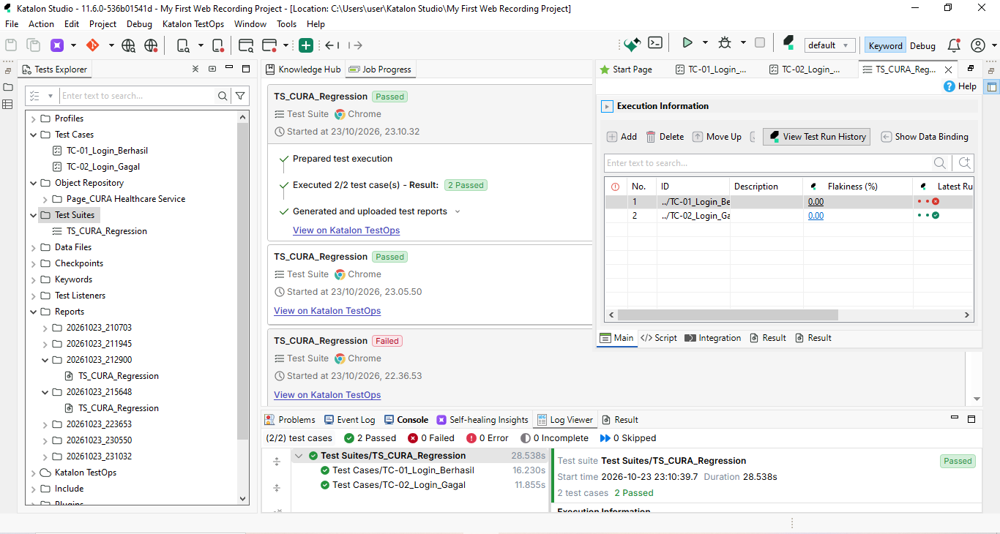

# Katalon Automation Portfolio — Yeshiana

Repositori ini berisi proyek automasi pengujian web menggunakan **Katalon Studio**. 
Sebagai QA dengan latar belakang manual testing, saya membangun portofolio ini untuk menunjukkan kemampuan dalam membuat *automated regression test*.

## Proyek: CURA Healthcare Service (Demo Site)
**Situs Uji:** `https://katalon-demo-cura.herokuapp.com/`
**Fokus:** Automated Regression Test pada alur utama (Login dan Skenario Negatif).

### Cakupan Test Case
1. **TC-01 (Positif):** Login berhasil dengan kredensial valid.
2. **TC-02 (Negatif):** Login gagal dengan password salah, divalidasi dengan *Assertion* pesan error.

### Struktur Repositori
- `Test Cases/` : Berisi script otomatisasi.
- `Test Suites/` : Kumpulan test case yang dijalankan sekaligus.
- `Object Repository/` : Kumpulan elemen UI.
- `screenshots/` : Bukti eksekusi (PASSED).

### Cara Menjalankan
1. Clone repositori ini.
2. Buka Katalon Studio, pilih **File > Open Project**, arahkan ke folder ini.
3. Buka `Test Suites/TS_CURA_Regression`.
4. Klik **Run** dan pilih browser (Chrome).

### Bukti Eksekusi

